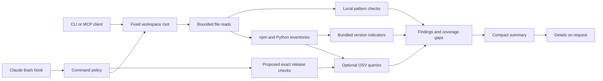

# Architecture

The scanner is deterministic Python. Target content is data: it never becomes an import, a subprocess, a shell command, a scanner plugin, or executable configuration. `guard.py` is a trusted launcher. Running it with `-I` avoids target-directory imports during Python startup. POSIX file-descriptor traversal refuses symlinks for every component of a file read.

Inventories and static signals are separate. A lock entry can establish a dependency version even when the source is absent. A source pattern can identify suspicious behavior without proving malicious intent. The report records these as distinct evidence types. OSV `MAL-*` records and exact bundled malicious releases are critical; other OSV advisories request review because the batch API does not provide severity or reachability.

The inventory audit compares supported manifest declarations and represented lock entries as data. It checks a conservative subset of stable-version constraint syntax and nearest npm lock-entry lookup. Unsupported syntax produces coverage gaps. Startup configuration is parsed separately, including JSON comments/trailing commas, and command/server launch declarations are returned as execution-surface findings. Static findings and startup parse gaps are cached together so an unchanged invalid configuration never loses its warning.

Proposed-dependency checks never run a resolver or download an artifact. Exact identities can be matched offline; online OSV checks require public provenance. The Bash target extractor is intentionally limited and does not authorize execution. Eligible proposed releases share a batched OSV lookup/time budget, separate from the project lookup. The result explicitly excludes transitive packages and artifact contents.

Only summary and finding retrieval enter the model context. Source text and downloaded advisory descriptions do not. Paths and package names remain untrusted metadata. Detailed reports contain fixed explanations, sanitized metadata, and advisory links. Content-hash caching applies to local pattern checks in one MCP process; dependency parsing and advisory queries run again. There is no persisted clean verdict to invalidate.

The MCP transport implements initialize, ping, tools/list, tools/call, and notifications over newline-delimited JSON-RPC. It exposes no HTTP listener, filesystem write tool, shell tool, external scanner adapter, remediation tool, or arbitrary endpoint option. It is a deliberately small implementation, tested with a stdio client; full MCP conformance and live integration with every agent client are not claimed.

The Bash hook uses a small policy rather than attempting a permissive shell allowlist. Suspicious patterns deny; simple recognized reads defer to native permissions; other commands require a scan and user review. Source changes between a scan and execution remain possible. Only an OS sandbox, execution broker, or immutable snapshot can enforce a stronger boundary.
