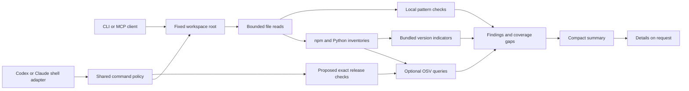
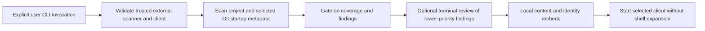

# Architecture

The scanner is deterministic Python. Target content remains data. `guard.py` is trusted source; Python `-I` avoids target-directory imports. POSIX descriptors refuse symlink components. Native Windows uses the separate local-NTFS backend described in [agent/platform coverage](AGENTS-AND-PLATFORMS.md). Both backends supply bounded reads and handle-based enumeration to the shared scanner/MCP engine.

Inventories and static signals are separate. A lock entry can establish a dependency version even when the source is absent. A source pattern can identify suspicious behavior without proving malicious intent. The report records these as distinct evidence types. OSV `MAL-*` records and exact bundled malicious releases are critical; other OSV advisories request review because the batch API does not provide severity or reachability.

The inventory audit compares supported manifest declarations and represented lock entries as data. It checks a conservative subset of stable-version constraint syntax and nearest npm lock-entry lookup. Unsupported syntax produces coverage gaps. Startup configuration is parsed separately, including JSON comments/trailing commas, and command/server launch declarations are returned as execution-surface findings. Static findings and startup parse gaps are cached together so an unchanged invalid configuration never loses its warning.

Proposed-dependency checks never run a resolver or download an artifact. Exact identities can be matched offline; online OSV checks require public provenance. The Bash target extractor is intentionally limited and does not authorize execution. Eligible proposed releases share a batched OSV lookup/time budget, separate from the project lookup. The result explicitly excludes transitive packages and artifact contents.

MCP returns structured scan summaries, command/dependency verdicts, and requested finding details to the model context. Source text and downloaded advisory descriptions do not enter those results. Paths and package names remain untrusted metadata. Detailed reports contain fixed explanations, sanitized metadata, and advisory links. Content-hash caching applies to local pattern checks in one MCP process; dependency parsing and advisory queries run again. There is no persisted clean verdict to invalidate.

The MCP transport implements initialize, ping, tools/list, tools/call, and notifications over newline-delimited JSON-RPC. It exposes no HTTP listener, filesystem write tool, shell tool, external scanner adapter, remediation tool, or arbitrary endpoint option. It is a deliberately small implementation, tested with a stdio client; full MCP conformance and live integration with every agent client are not claimed.

Shell adapters share a conservative policy: suspicious patterns deny, simple reads defer to native permissions, and other execution triggers a scan. Claude can request native review. Codex's strict adapter converts review cases to explicit denials and emits JSON denials on local check errors; native startup/timeout failures can continue. Neither adapter authorizes by unsupported output fields. Source can change between checking and execution; stronger isolation needs a sandbox/broker/snapshot.

## Pre-launch gate

`launch` is a separate CLI execution operation, not a scanner side effect or an MCP tool. It requires Python isolated mode and rejects a scanner/client executable inside the inspected root. It copies and sanitizes the child environment without modifying the parent, and passes a frozen argument tuple to subprocess execution.

The standard scan computes a stable fingerprint of selected file names and byte hashes. Launch adds selected Git metadata and the scanner version. Review is local, ephemeral, and limited to complete checks with lower-priority findings. Its random terminal challenge does not establish operator identity or act as a reusable capability. High-priority/incomplete cases stop without approval.

The second inspection makes no new advisory requests and compares selected content, static findings, root identity, and client metadata. A five-minute limit bounds the initial preflight window. Changed or expired state stops execution. Client/global configuration and the client installation are trusted inputs; runtime isolation, atomic filesystem state, and complete client configuration discovery are outside this implementation.

## Explicit integration setup and diagnostics

`agents.py` declares selected-agent profile paths, contract references, failure/review capabilities, and canonical commands. `integration.py` builds two user-hook groups from trusted paths. Explicit isolated-Python setup uses `config_io.py`, dispatching to POSIX owner/mode/fcntl safeguards or native Windows owner/DACL/handle/lock safeguards. Both retain private original-byte backups, compare snapshots, and replace atomically within their documented limits. Uninstall edits current settings, preserving later unrelated changes.

Configuration inspection compares canonical groups, arguments, failure policy, and root project hook-disable controls as data. The optional doctor probe reconstructs trusted argv independently of settings content, sanitizes its environment, and invokes only the guard for inert deny/read/error events. It does not call configured third-party hooks or a native client. Both setup and diagnostics report the minimum supported failure-policy version and leave actual client version/loading/enforcement unverified. None of these configuration-write operations is exposed through MCP or called as a side effect of scanning.

The [CLI reference](CLI.md) defines arguments/statuses. Agent profiles honor `CODEX_HOME`/`CLAUDE_CONFIG_DIR` and explicit overrides; full native precedence/trust still requires verification. Moving the checkout/interpreter requires configuration review and restarts. No executable or rule updater runs automatically.

## First-time terminal workflow

`onboarding.py` coordinates user-invoked `setup`, `demo`, and `open`. Setup previews the existing secure configuration editor, requires terminal consent for writes, and passes the original settings snapshot through to apply so detected prompt-time changes conflict. It uses the existing doctor/probe paths after applying settings and never promotes their result into verified native enforcement. An optional shell-quoted alias or PowerShell function is printed; no executable wrapper or shell startup edit is installed.

`demo` exercises the same reconstructed hook protocol cases in an empty temporary project. No example command runs, project code loads, or advisory request occurs. `open` discovers a client only on the sanitized external PATH (or takes an explicit absolute client) and delegates to the existing launcher. A receipt formatter affects presentation only; high-priority/incomplete refusal, snapshot rechecks, and terminal challenges remain in the launch gate. All review metadata remains visible before the challenge.

`presentation.py` formats readable scan/diagnostic/setup/launch results with bounded sanitized metadata and explicit missing-check explanations. `check --json`, legacy CLI JSON, MCP, and hook protocols retain their structured interfaces. No model call or third-party runtime dependency is added. See [Getting started](GETTING-STARTED.md) for the user journey and [Detailed usage](USAGE.md) for the expanded technical guide.

## Native Windows boundary

`windows_files.py` binds system APIs through stdlib ctypes, on Windows only. It restricts roots to local fixed NTFS, validates path components, opens children relative to held directory handles, rejects reparse/special objects, enumerates bounded native packets, and validates regular bounded reads. Read pins disallow write/delete sharing; secure settings-parent pins permit write sharing required by native rename while retaining handle identity. Settings ACLs conservatively accept only known entries, validated owners and scoped OWNER RIGHTS, with no foreign writes. New files have protected current-user/SYSTEM/Administrators ACLs.

`windows_config.py` takes native byte-range locks, compares snapshot bytes/identity/ACLs, writes and flushes private backups/staging files, rechecks, and renames relative to the pinned parent. It reports an applied change if final file flush fails, and leaves directory durability explicitly unattested. It does not claim that NTFS or native agent sessions are sandboxed. Windows client launch is `.exe` only; batch shims are refused to avoid implicit shell interpretation.

The gate rejects project-contained/nonexecutable POSIX `SHELL` values. On Windows it resets shell/system-directory variables using `GetSystemDirectoryW`, disables current-directory executable lookup, and removes `PSModulePath`. The Codex relay also obtains its fixed PowerShell location from that native API rather than inherited environment values.
